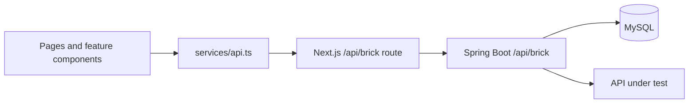

# Frontend development guide

This guide describes the current implementation. Start with the [README](../README.md) for the product walkthrough and installation commands. Database and execution-service setup belongs in the [backend development guide](https://github.com/graham-gc/brick-platform-backend/blob/main/docs/development.md).

## Service addresses

The browser always calls same-origin `/api/brick/...`. `src/app/api/brick/[...path]/route.ts` forwards the path and query string to `API_BASE_URL`.

| Where Next.js runs | Where the backend runs | `API_BASE_URL` |
| --- | --- | --- |
| Host | Host, port 8080 | `http://localhost:8080/api/brick` |
| Host | Docker with host port 8080 published | `http://localhost:8080/api/brick` |
| Compose frontend container | Compose backend service | `http://backend:8080/api/brick` (already configured by Compose) |
| Standalone frontend container on Docker Desktop | Host, port 8080 | `http://host.docker.internal:8080/api/brick` |

Use the actual published port if you changed `BACKEND_PORT`. A Docker service name such as `backend` resolves inside the Compose network, not in a native Next.js process. `host.docker.internal` in the last row assumes Docker Desktop; other Docker installations may require explicit host routing.

Swagger-source URLs and target API addresses are interpreted by the **Spring Boot backend**, which fetches contracts and executes tests. Browser reachability alone does not establish that the backend can reach an API. The built-in commerce mock runs in that same backend process and listens on loopback at port `9090` by default.

`API_BASE_URL` is read by the server-side route handler. Keep it in `.env.local` for native development or pass it to the runtime container. It is not a browser setting and should not be renamed to `NEXT_PUBLIC_API_BASE_URL`. Restart the server after editing it.

## Request and state boundaries



- `src/services/api.ts` expects `{ success, message, data }`, rejects non-JSON responses and unsuccessful results, and returns `data` to callers.
- The BFF implements `GET`, `POST`, `PUT`, and `DELETE`. It forwards content type and a validated/generated `X-Request-ID`; it is not a general header or browser-cookie relay. Headers for APIs under test are configured in flow/node data.
- The BFF preserves the backend response status, content type, and request ID. Connection failures return JSON with HTTP `502` and an `X-Request-ID`.
- TanStack Query owns fetched data and mutation state. The flow designer owns its local React Flow nodes, edges, viewport, and dirty state. The Zustand store exists for shared client state; it is not the persisted canvas source of truth.

## Source map

Paths below are relative to this repository.

| Area | Entry point | Responsibility |
| --- | --- | --- |
| App shell | `src/app/(main)/layout.tsx`, `src/app/providers.tsx` | Navigation, Ant Design context, and Query provider |
| Contract import | `src/app/(main)/mappings/page.tsx` | Validate a URL/file, create a mapping, and import or refresh endpoints |
| Interface inspection | `src/app/(main)/endpoints/page.tsx` | Endpoint search and resolved request/response details |
| Create/edit flow | `src/app/(main)/flows/new/page.tsx`, `src/app/(main)/flows/[id]/page.tsx` | Page-level loading, save mutations, and execution |
| Canvas | `src/features/flow-designer/FlowDesigner.tsx` | Independent node IDs, connections, selection, and save payloads |
| Node configuration | `src/features/flow-designer/NodeEditorModal.tsx` | Requests, response variables, request bindings, and assertions |
| Variable helpers | `src/features/flow-designer/context-variables.ts` | JSONPath selection modes and schema-derived target fields |
| Reports | `src/features/run-result/`, `src/app/(main)/runs/` | Immediate result drawer and persisted run diagnostics |
| API contract | `src/services/api.ts`, `src/types/index.ts` | Endpoint calls and TypeScript domain models |

## Preview a contract update

In **Swagger Mappings**, choose **Sync**, validate the updated URL or JSON file, and select **Preview Impact**. The preview compares the saved response schema to the incoming schema and lists saved flow nodes whose response variables or enabled JSONPath assertions refer to fields that are no longer declared.

Open an affected node in a new tab to review its **Response Variables** or **Assertions**. The preview leaves the existing mapping unchanged. Select **Sync Endpoints** to apply the document you reviewed, or go back to change the input.

The preview shows completed comparisons, affected references, and references it could not assess. Missing responses, unresolved or composed schemas, and unsupported JSONPath expressions are shown with a reason and a link to the saved node. A preview with unassessed references is incomplete even if it reports no affected fields. The check covers field removal for simple paths and does not validate type changes.

## Canvas save and execution

`endpointId` identifies the reusable API definition. A canvas node has its own `id`, so the same endpoint can be added repeatedly with different inputs and assertions. New nodes and edges use negative temporary IDs.

Saving submits the full flow, node list, and edge list. An edit first posts the update, then reloads the complete flow. The page updates the query cache and remounts the designer with persisted IDs. Creating a flow reads the returned flow ID and navigates to its edit page. Edge IDs and assertion-definition IDs can change after saving; do not use them as permanent UI identities across reloads.

Keep the existing node `assertions` when updating other node fields. The backend replaces that list on save, and omitted assertions are cleared. JSON configuration fields such as `payloadJson` and `responseVariablesJson` are serialised strings in the API model. See the [flow save contract](https://github.com/graham-gc/brick-platform-backend/blob/main/docs/flow-save-frontend-contract.md) for the exact replacement rules and responses.

Run operates on saved backend data. The editor disables Run while the canvas is dirty. Execution is synchronous, so the run mutation remains pending until the backend finishes; the returned run ID opens the result drawer.

If a save succeeds but the subsequent reload fails, reload the persisted flow before retrying edits. Reposting an old payload containing temporary IDs can create those nodes again.

## Interpreting results

| Field | Meaning |
| --- | --- |
| Response envelope `success` | Whether the Brick API operation returned successfully; it does not assert that a test passed |
| Run/node `status` | Request execution and dependency outcome, such as `running`, `success`, `failed`, or node-level `blocked` |
| `businessStatus` | Assertion outcome: `passed`, `failed`, `not_configured`, or `not_evaluated` |

Receiving an HTTP response, including `401` or `500`, counts as successful request execution. Add a `status_code` assertion to enforce an expected HTTP code. A run can have `status: "success"` and `businessStatus: "failed"`; show both outcomes. Failed assertions do not themselves block downstream nodes.

Response extraction and request binding use explicit variable definitions. Global variables use `${{name}}` or `${{functionName(...)}}`. Flow headers can reference extracted variables through `{{name}}`; a header binding can format its selected value with `{{value}}`, for example `Bearer {{value}}`. These forms serve different purposes.

## Manual smoke checklist

Run with a working backend and database. This is a checklist, not a record of completed browser tests.

- [ ] Import the built-in commerce OpenAPI URL through Swagger Mappings and confirm endpoint import completes automatically.
- [ ] Inspect an endpoint's resolved request/response schema and example values.
- [ ] Add the same endpoint three times, connect the nodes, save, and refresh. Confirm all three independent nodes remain.
- [ ] Configure a response variable and a downstream binding. Save and refresh to confirm the configuration persists.
- [ ] Configure Flow Headers, a node header override, and a status-code assertion. Confirm these persist after saving.
- [ ] Confirm an unsaved canvas cannot run, and saving restores Run availability.
- [ ] Run a valid flow, inspect the immediate result, and open the persisted report from Run History.
- [ ] Make an assertion fail while requests still return responses. Confirm the report distinguishes request success from assertion failure.
- [ ] Add the flow to a Test Suite and inspect the suite result.
- [ ] Stop the backend and trigger a data request. Confirm the UI displays a connection error.

## Checks and maintenance

```bash
npm run lint
npx tsc --noEmit --incremental false
npm run build
```

CI uses Node.js 22 and runs lint, the production build, and the container build. There is currently no frontend unit-test or browser-test command. A passing type check or build does not replace the interaction checks above.

This checkout uses Next.js 16.2.10. Before changing Next.js code, follow [AGENTS.md](../AGENTS.md) and read the relevant version-matched guide under `node_modules/next/dist/docs/`. The local guides for route handlers and backend-for-frontend behaviour are especially relevant to the proxy.

## Troubleshooting

| Symptom | What to check |
| --- | --- |
| `Unable to connect to the backend service` / HTTP 502 | Check backend health directly, the Next.js server's `API_BASE_URL`, and host/container address context. Restart Next.js after environment changes. |
| UI loads but lists are empty | Confirm a mapping has been imported and the page's application/environment/version selection matches it. |
| Mapping was created but import failed | Reopen that mapping and synchronise it after fixing the reported contract/backend error; creating another mapping is unnecessary. |
| Swagger URL works in the browser but import fails | Check whether that same address is reachable from the backend process/container. |
| Docker host cannot open mock port 9090 | The mock binds to backend loopback. Import `http://localhost:9090/openapi.json` through Brick. |
| Run is disabled | Save the canvas first; execution uses persisted flow data. |
| A function variable cannot execute | Confirm the backend uses JDK 8 and the variable is created, enabled, and has valid parameters. |

For a failed request, capture `X-Request-ID` from the browser network response and find the same ID in backend logs. The current API client displays the error message but does not automatically include the request ID in the toast.
